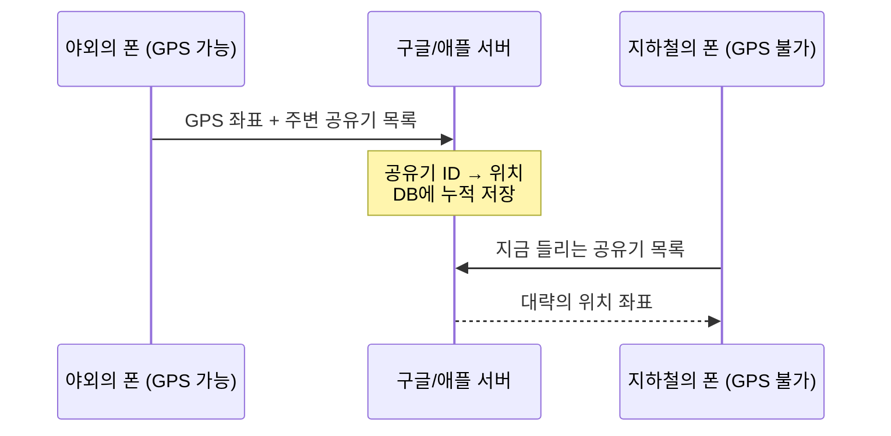

지도 앱을 켜면 파란 점이 내 위치에 콕 찍힌다. 휴대폰은 위성에 아무 말도 안 하는데 어떻게 내 위치를 알까?
알고 보면 **중학교 수학 수준의 연립방정식 하나**를 푸는 일이다. 그리고 지하철이나 건물 안에서는 GPS를 아예 못 쓰는데도 점이 움직이는 이유까지 이어서 정리해본다.

## 위성은 "방송"만 한다

GPS 위성은 지상 약 20,200km 상공에 약 31개가 돌고 있고(미국 우주군 소유), 쉴 새 없이 이런 내용을 전 지구로 방송한다.

> 나는 위성 A다. 내 현재 위치는 (x, y, z)다. 이 신호를 **09:00:00.000000000**에 보냈다.

휴대폰은 이걸 **듣기만** 한다. 라디오가 방송국에 신호를 보내지 않는 것과 같다.
수십억 대가 위성에 신호를 쏘면 위성이 감당할 수 없으니, 계산은 전부 휴대폰 칩이 혼자 한다.

## 위성 3개면 위치가 나온다

하늘에 보이는 위성 중 신호가 센 3개를 고른다. 각 위성에 대해 휴대폰은 두 가지를 안다.

- 위성의 위치 $(x_1, y_1, z_1)$: 신호 안에 적혀 있다.
- 위성까지의 거리: 신호가 날아온 시간 × 빛의 속도

예를 들어 09:00:00.000에 출발한 신호가 09:00:00.067에 도착했다면, $300{,}000\,\text{km/s} \times 0.067\,\text{s} \approx 20{,}100\,\text{km}$ 떨어져 있다는 뜻이다.

내 위치를 $(x, y, z)$라고 하면 "내 위치와 위성 사이의 거리"는 피타고라스 정리로 쓸 수 있고, 이게 방금 구한 거리와 같아야 한다.

$$\sqrt{(x - x_{\text{위성1}})^2 + (y - y_{\text{위성1}})^2 + (z - z_{\text{위성1}})^2} = \text{빛의속도} \times (t_{\text{수신}} - t_{\text{발신1}})$$

$$\sqrt{(x - x_{\text{위성2}})^2 + (y - y_{\text{위성2}})^2 + (z - z_{\text{위성2}})^2} = \text{빛의속도} \times (t_{\text{수신}} - t_{\text{발신2}})$$

$$\sqrt{(x - x_{\text{위성3}})^2 + (y - y_{\text{위성3}})^2 + (z - z_{\text{위성3}})^2} = \text{빛의속도} \times (t_{\text{수신}} - t_{\text{발신3}})$$

미지수는 $x, y, z$ 3개, 식도 3개. **3원 2차 연립방정식**이니 풀린다. 이걸 기하학으로 보면 이렇다.

- 위성 1개: "위성 1에서 20,100km 떨어진 구 표면 어딘가"
- 위성 2개: 두 구가 만나 **원**이 된다.
- 위성 3개: 세 구가 만나 **점 두 개**가 남는다. 하나는 우주 밖의 말도 안 되는 좌표라서 버리면, 지구 표면의 점 하나가 내 위치다.

{: width="680"}
_세 위성이 놓인 평면을 옆에서 본 모습. 세 구가 정확히 같은 두 점에서 만나고, 그중 지구 쪽 점이 내 위치다_

이게 **삼변측량(Trilateration)**이다. 여기까지만 이해해도 GPS 원리의 90%는 끝이다.

## 그런데 현실에서는 풀리지 않는다: $t_{\text{error}}$

위 식에는 숨은 가정이 하나 있다. **휴대폰 시계가 위성 시계만큼 정확하다**는 가정이다.

- 위성: 원자시계. 1초 틀어지는 데 수백만 년.
- 휴대폰: 몇백 원짜리 수정 진동자. 일상에는 충분하지만 나노초 단위 정밀도는 없다.

문제는 빛이 너무 빠르다는 것이다. 시계가 **1마이크로초(100만 분의 1초)만 틀려도 약 300m 오차**가 난다.
내 폰 시계가 0.003초만 빨라도 거리가 900km나 부풀려진다.

이렇게 시계 오차 때문에 왜곡된 거리를 **의사거리(Pseudorange)**라고 부른다.

$$\text{측정된 거리} = \text{진짜 거리} + \text{빛의속도} \times t_{\text{error}}$$

### 트릭: 오차는 모든 위성에 똑같다

내 폰 시계가 0.003초 빠르다면, 1번 위성을 잴 때도 2번, 3번 위성을 잴 때도 **똑같이 0.003초** 빠르다. 오차는 위성마다 다른 게 아니라 **하나의 상수**다.
그러니 이 오차도 그냥 **미지수로 추가**하면 된다.

$$\sqrt{(x - x_1)^2 + (y - y_1)^2 + (z - z_1)^2} = c \times (t_{\text{수신}} - t_{\text{발신1}} - t_{\text{error}})$$

$$\sqrt{(x - x_2)^2 + (y - y_2)^2 + (z - z_2)^2} = c \times (t_{\text{수신}} - t_{\text{발신2}} - t_{\text{error}})$$

$$\sqrt{(x - x_3)^2 + (y - y_3)^2 + (z - z_3)^2} = c \times (t_{\text{수신}} - t_{\text{발신3}} - t_{\text{error}})$$

$$\sqrt{(x - x_4)^2 + (y - y_4)^2 + (z - z_4)^2} = c \times (t_{\text{수신}} - t_{\text{발신4}} - t_{\text{error}})$$

미지수가 $x, y, z, t_{\text{error}}$로 **4개**가 됐으니 식도 4개 필요하다. **GPS가 위성을 최소 4개 요구하는 이유**가 이것이다.

풀고 나면 위치만 나오는 게 아니라 "내 폰 시계가 정확히 +0.003초 빨랐구나"까지 같이 나온다.
덕분에 휴대폰은 GPS를 잡는 순간 나노초 단위의 원자시계급 시각까지 공짜로 얻는다. 비싼 원자시계를 폰에 넣는 대신, 위성 1개를 더 받아서 수학으로 시계를 맞추는 셈이다.

> 위성 신호 자체는 잡음보다 약해서, 휴대폰은 각 위성 고유의 디지털 패턴(PRN 코드)을 밀고 당기며 맞춰보는 방식으로 신호를 건져낸다. 신호를 잡는 것과 위치를 계산하는 것은 별개의 단계다.
{: .prompt-info }

## 그럼 지하철과 건물 안은?

GPS 신호의 약점은 **약하다**는 것이다. 20,000km 밖에서 쏜 수십 W짜리 전파라 지상에 도달하면 극도로 약해져서, 콘크리트와 흙을 거의 못 뚫는다.
지하철 터널이나 건물 깊숙한 곳에서는 위성이 4개는커녕 1개도 안 잡힌다.

그런데도 지하철에서 파란 점은 역을 따라 움직인다. **GPS를 쓰는 게 아니라 다른 단서로 위치를 추정**하는 것이다.

### 공유기(Wi-Fi AP)가 위치 단서가 된다

핵심은 주변 공유기다. 모든 공유기는 전 세계에서 유일한 식별 번호(**BSSID, MAC 주소**)를 계속 뿌리고 있다. 우리가 접속하지 않아도, 비밀번호가 걸려 있어도 이 번호는 들을 수 있다.

그리고 이 "공유기 → 위치" 대응표를 **구글과 애플의 서버가 이미 가지고 있다.**

1. **쌓기**: GPS가 잘 되는 곳에 있는 수많은 폰이 "내 좌표는 여기고, 주변에 이런 공유기가 보인다"를 서버에 올린다. 서버는 이걸 모아 "이 공유기는 이 근처에 있다"는 거대한 지도를 만든다.
2. **조회**: GPS가 안 되는 곳의 폰은 "지금 이런 공유기들이 들린다"를 서버에 물어보고, 서버는 그 공유기들의 위치를 근거로 **좌표를 계산해서 돌려준다.** 신호 세기(RSSI)가 센 공유기일수록 가까이 있다고 보고 가중치를 준다.
3. **지하철**: 역사와 객차 안 공유기, 터널 안 이동통신 중계기까지 같은 방식으로 DB에 쌓여 있다. 그래서 승강장에 들어오면 폰이 "합정역 승강장 공유기가 세게 잡히네" 하고 역 위치를 받아온다.

즉 GPS는 **폰이 혼자 계산**하는 방식이고, 실내 측위는 **서버에 물어보고 답을 받는** 방식이다. 위성은 방송이고, 이쪽은 질의응답이다.
기지국 신호도 똑같이 "기지국 ID → 위치" DB로 쓰인다.

### 그래도 모자라는 부분은 앱이 메운다

- **관성 센서(추측항법)**: 터널에 들어가기 직전 좌표를 기준점으로 삼고, 가속도·자이로 센서로 "얼마나 갔고 어디로 꺾었는지"를 계산한다.
- **맵 매칭**: 지도 앱은 내가 지하철 노선 위에 있다는 걸 알기 때문에, 오차가 있어도 파란 점을 선로 위로 자석처럼 붙여준다.

그래서 지하철에서 파란 점이 가끔 지상 도로로 순간이동하거나, 열차가 멈췄는데 점만 다음 역으로 가다 되돌아오는 일이 생긴다. 근처 다른 건물의 공유기를 잘못 집었거나, 센서 추정이 어긋난 것이다.

## 위성도 안 닿고 LTE/5G도 안 터지면?

여기서 한 가지 약점이 보인다. 실내 측위는 결국 **서버에 물어봐야** 답이 나온다. 그러면 위성 신호도 안 닿고 LTE/5G도 안 터지는 곳에서는 사실상 위치를 계산할 방법이 막힌다.

- **깊은 동굴, 지하 광산, 심해 터널**: 하늘이 막혀 위성 신호가 0%이고 중계기도 없다.
- **통신이 끊긴 지하 주차장**: 주변에 공유기가 아무리 많이 들려도, 그 ID를 구글/애플 서버에 보내 "여기가 어디냐"고 물어볼 인터넷 연결이 없으니 무용지물이다.

이런 곳에서는 파란 점이 엉뚱한 곳에 멈춰 있거나 "위치 정보를 찾을 수 없습니다"라는 에러만 뜬다.

그래도 제한적으로 버티는 수단이 둘 있다.

1. **관성 센서 추측항법**: 지상에서 위치를 잡은 채 막 들어왔을 때 유효하다. 가속도계와 자이로스코프는 통신 없이 폰 안에서 동작하므로 "마지막 위치에서 서쪽으로 초속 1m로 30초 걸었다" 식으로 궤적을 이어간다. 다만 센서 노이즈가 누적돼서 2~3분만 지나도 오차가 수십~수백 미터로 벌어진다.
2. **로컬 캐시**: 집이나 회사처럼 자주 가는 곳의 공유기 정보는 OS가 폰 안에 임시로 저장해 두는 경우가 있다. 그러면 LTE가 끊겨도 "이 공유기는 아까 집이라고 저장해 둔 그거네" 하고 로컬에서 위치를 찍을 수 있다. 하지만 처음 가보는 지하 공간에서는 불가능하다.

## 정리

| 상황 | 위치를 얻는 방법 | 누가 계산하나 |
| --- | --- | --- |
| 야외 | 위성 4개 신호 → 4원 연립방정식 | 폰 (혼자) |
| 지하철/건물 안 | 주변 공유기·기지국 ID → 서버 DB 조회 | 구글/애플 서버 |
| 그 사이 | 가속도·자이로 추정 + 지도 맵 매칭 | 폰/앱 |
| 위성·통신 모두 불가 | 추측항법 + 로컬 캐시 (몇 분이 한계) | 폰 (혼자) |

- GPS는 위성 3개의 거리로 위치를 구하는 **3원 2차 연립방정식**이고, 여기에 폰 시계 오차 $t_{\text{error}}$를 미지수로 넣느라 **위성이 4개** 필요하다.
- 위성은 방송만 하고, 계산은 폰이 한다.
- 실내에서는 GPS 대신 **공유기·기지국 위치 DB**를 쥔 구글/애플 서버가 답을 돌려주고, 센서와 맵 매칭이 빈틈을 메운다.
- 위성도 통신도 없는 곳은 서버에 물어볼 수 없으니, 추측항법과 로컬 캐시로 몇 분 버티는 게 한계다.
