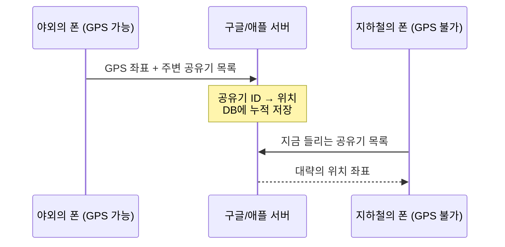

휴대폰 GPS가 어떻게 위치를 잡는지 궁금해서 Gemini와 주고받은 내용을 정리했다.
위성과 폰이 통신하는 줄 알았는데 그게 아니었고, 핵심은 연립방정식 하나였다.
파고들다 보니 GPS가 안 터지는 지하철에서 파란 점이 움직이는 이유까지 나왔다.

## 1. 위성은 방송만 한다

**흔한 오해: 폰이 위성과 통신한다.**

아니다. 폰은 위성에 아무것도 보내지 않고 **듣기만** 한다. 라디오가 방송국에 신호를 보내지 않는 것과 같다.
위성은 약 31개가 지상 2만km 상공을 돌면서 이것만 계속 방송한다.

> 나는 위성 A다. 내 위치는 (x, y, z)다. 이 신호는 **09:00:00.000000000**에 보냈다.

수십억 대가 위성에 신호를 쏘면 위성이 감당이 안 된다. 그래서 **계산은 전부 폰 칩이 혼자 한다.**
애초에 폰 출력으로는 2만km 밖까지 신호를 쏠 수도 없다.

## 2. 위성 3개면 위치가 나온다

신호가 센 위성 3개를 고른다. 위성마다 폰이 아는 건 둘이다.

- 위성의 위치 $(x_1, y_1, z_1)$: 신호 안에 적혀 있다.
- 위성까지의 거리: 빛의 속도 × 신호가 날아온 시간

예를 들어 09:00:00.000에 출발한 신호가 09:00:00.067에 도착했다면 $300{,}000\,\text{km/s} \times 0.067\,\text{s} \approx 20{,}100\,\text{km}$다.

내 위치를 $(x, y, z)$라고 하면, 내 위치와 위성 사이 거리는 피타고라스 정리로 쓸 수 있고 이게 방금 구한 거리와 같아야 한다.

$$\sqrt{(x - x_{\text{위성1}})^2 + (y - y_{\text{위성1}})^2 + (z - z_{\text{위성1}})^2} = \text{빛의속도} \times (t_{\text{수신}} - t_{\text{발신1}})$$

$$\sqrt{(x - x_{\text{위성2}})^2 + (y - y_{\text{위성2}})^2 + (z - z_{\text{위성2}})^2} = \text{빛의속도} \times (t_{\text{수신}} - t_{\text{발신2}})$$

$$\sqrt{(x - x_{\text{위성3}})^2 + (y - y_{\text{위성3}})^2 + (z - z_{\text{위성3}})^2} = \text{빛의속도} \times (t_{\text{수신}} - t_{\text{발신3}})$$

미지수 $x, y, z$ 3개에 식도 3개다. **3원 2차 연립방정식**이고, 풀면 끝이다.

기하로 보면 이렇다.

- 위성 1개: 위성에서 20,100km 떨어진 구 표면 어딘가
- 위성 2개: 두 구가 만나 **원**
- 위성 3개: 세 구가 만나 **점 2개**. 하나는 우주 쪽이라 버리고, 지구 쪽 점이 내 위치다.

{: width="680"}
_세 위성이 놓인 평면을 옆에서 본 모습. 세 구가 정확히 같은 두 점에서 만나고, 그중 지구 쪽 점이 내 위치다_

점이 2개인 이유는 식을 빼보면 알 수 있다. 구 1에서 구 2를 빼면 제곱항이 다 사라지고 **평면**이 남는다. 구 3도 똑같이 하면 평면이 하나 더 나오고, 평면 두 개는 직선에서 만난다.
이 직선이 구를 뚫고 지나가는 두 점이 해다. 이건 일반적인 경우고, 세 위성이 일직선에 가깝게 놓이면 해가 불안정해진다.

## 3. 4번째 위성이 필요한 이유: $t_{\text{error}}$

위 식에는 숨은 가정이 하나 있다. **폰 시계가 위성 시계만큼 정확하다**는 것이다.

- 위성: 원자시계. 1초 틀어지는 데 수백만 년이 걸린다.
- 폰: 몇백 원짜리 수정 진동자. 일상에는 충분하지만 나노초 단위는 못 맞춘다.

문제는 빛이 너무 빠르다는 점이다. 시계가 **1마이크로초만 틀려도 300m**가 어긋난다.
폰 시계가 0.003초만 빨라도 거리가 900km 부풀려진다. 시계 오차 때문에 왜곡된 이 거리를 **의사거리(Pseudorange)**라고 부른다.

$$\text{측정된 거리} = \text{진짜 거리} + \text{빛의속도} \times t_{\text{error}}$$

**핵심은 이 오차가 모든 위성에 똑같다는 것이다.** 폰 시계가 0.003초 빠르면 1번 위성을 잴 때도, 2번, 3번 위성을 잴 때도 똑같이 0.003초 빠르다.
위성마다 다른 값이 아니라 상수 하나다. 그러면 이것도 그냥 미지수로 넣으면 된다.

$$\sqrt{(x - x_1)^2 + (y - y_1)^2 + (z - z_1)^2} = c \times (t_{\text{수신}} - t_{\text{발신1}} - t_{\text{error}})$$

$$\sqrt{(x - x_2)^2 + (y - y_2)^2 + (z - z_2)^2} = c \times (t_{\text{수신}} - t_{\text{발신2}} - t_{\text{error}})$$

$$\sqrt{(x - x_3)^2 + (y - y_3)^2 + (z - z_3)^2} = c \times (t_{\text{수신}} - t_{\text{발신3}} - t_{\text{error}})$$

$$\sqrt{(x - x_4)^2 + (y - y_4)^2 + (z - z_4)^2} = c \times (t_{\text{수신}} - t_{\text{발신4}} - t_{\text{error}})$$

미지수가 $x, y, z, t_{\text{error}}$ 4개가 됐으니 식도 4개 필요하다. **위성이 최소 4개 필요한 이유**다.

풀면 위치뿐 아니라 "내 폰 시계가 정확히 +0.003초 빨랐다"까지 같이 나온다. 원자시계를 폰에 넣을 수는 없으니, 위성 하나를 더 받아서 수학으로 시계를 맞추는 것이다.
덕분에 GPS를 잡는 순간 폰은 나노초 단위의 정확한 시각도 공짜로 얻는다.

## 4. 지하철과 건물 안에서는

GPS 신호는 약하다. 2만km 밖에서 수십 W로 쏜 전파라 지상에 오면 콘크리트와 흙을 거의 못 뚫는다. 지하철 터널이나 건물 깊숙한 곳에서는 위성이 4개는커녕 1개도 안 잡힌다.

그런데도 지하철에서 파란 점은 역을 따라 움직인다. **GPS가 아니라 다른 단서로 위치를 추정**하는 것이다.

### 공유기가 위치 단서다

모든 공유기(Wi-Fi AP)는 전 세계에서 유일한 식별 번호(**BSSID, MAC 주소**)를 계속 뿌린다. 접속하지 않아도, 비밀번호가 걸려 있어도 이 번호는 들린다.
그리고 이 "공유기 → 위치" 대응표를 **구글과 애플 서버가 이미 가지고 있다.**

_야외의 폰이 DB를 채우고, GPS가 안 되는 폰이 그걸 조회한다_

1. **쌓기**: GPS가 되는 곳의 수많은 폰이 "내 좌표는 여기고, 주변에 이런 공유기가 보인다"를 서버에 올린다. 서버는 이걸 모아 "이 공유기는 이 근처"라는 거대한 지도를 만든다.
2. **조회**: GPS가 안 되는 폰은 "지금 이런 공유기들이 들린다"를 서버에 물어보고, 서버가 그 공유기들의 위치로 **좌표를 계산해서 돌려준다.** 신호 세기(RSSI)가 센 공유기일수록 가까이 있다고 보고 가중치를 준다.
3. **지하철**: 역사와 객차 안 공유기, 터널 안 중계기까지 같은 DB에 쌓여 있다. 승강장에 들어오면 폰이 "합정역 승강장 공유기가 세게 잡힌다"고 서버에 물어보고 역 위치를 받는다.

정리하면 GPS는 **폰이 혼자 계산**하고, 실내 측위는 **서버에 물어보고 답을 받는다.** 위성은 방송이고, 이쪽은 질의응답이다. 기지국도 "기지국 ID → 위치" DB로 똑같이 쓰인다.

### 모자라는 부분은 앱이 메운다

- **관성 센서(추측항법)**: 터널에 들어가기 직전 좌표를 기준으로, 가속도·자이로 센서로 얼마나 갔고 어디로 꺾었는지 계산한다.
- **맵 매칭**: 지도 앱은 내가 지하철 노선 위에 있다는 걸 알기 때문에, 오차가 있어도 파란 점을 선로 위로 붙여준다.

그래서 파란 점이 가끔 지상 도로로 순간이동하거나, 열차가 멈췄는데 점만 다음 역으로 갔다 돌아온다. 근처 다른 건물 공유기를 잘못 집었거나 센서 추정이 어긋난 것이다.

## 5. 위성도 통신도 안 되면

실내 측위는 결국 **서버에 물어봐야** 답이 나온다. 그러면 위성도 안 닿고 LTE/5G도 안 터지는 곳에서는 사실상 위치 계산이 막힌다.

- **깊은 동굴, 지하 광산, 심해 터널**: 위성 신호도 중계기도 없다.
- **통신이 끊긴 지하 주차장**: 공유기가 아무리 많이 들려도 그 ID를 서버에 보낼 수단이 없으니 쓸모가 없다.

이런 곳에서는 파란 점이 엉뚱한 곳에 멈추거나 "위치 정보를 찾을 수 없습니다"만 뜬다. 그래도 제한적으로 버티는 수단이 둘 있다.

1. **관성 센서 추측항법**: 지상에서 위치를 잡고 막 들어왔을 때 유효하다. 가속도계와 자이로는 통신 없이 폰 안에서 돈다. 다만 노이즈가 누적돼서 2~3분만 지나도 오차가 수십~수백 m로 벌어진다.
2. **로컬 캐시**: 집이나 회사처럼 자주 가는 곳의 공유기 정보를 OS가 폰 안에 임시로 저장해 두는 경우가 있다. 처음 가보는 지하 공간에서는 안 통한다.

## 정리

| 상황 | 위치를 얻는 방법 | 누가 계산하나 |
| --- | --- | --- |
| 야외 | 위성 4개 신호 → 4원 연립방정식 | 폰 (혼자) |
| 지하철/건물 안 | 주변 공유기·기지국 ID → 서버 DB 조회 | 구글/애플 서버 |
| 그 사이 | 가속도·자이로 추정 + 지도 맵 매칭 | 폰/앱 |
| 위성·통신 모두 불가 | 추측항법 + 로컬 캐시 (몇 분이 한계) | 폰 (혼자) |

- GPS는 위성 3개의 거리로 푸는 **3원 2차 연립방정식**이다. 폰 시계 오차 $t_{\text{error}}$를 미지수로 넣느라 **위성이 4개** 필요하다.
- 위성은 방송만 하고 계산은 폰이 한다.
- 실내에서는 **공유기·기지국 위치 DB**를 쥔 구글/애플 서버가 답을 돌려주고, 센서와 맵 매칭이 빈틈을 메운다.
- 위성도 통신도 없으면 서버에 물어볼 수 없다. 추측항법과 로컬 캐시로 몇 분 버티는 게 한계다.
