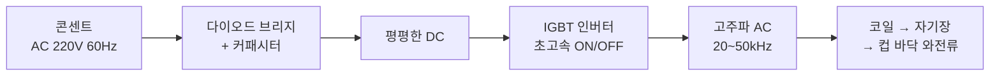

한강 편의점에서 종이컵에 라면을 끓여주는 기계를 보고 Gemini에게 "원리가 뭘까"를 물었다.
질문을 하나씩 따라가다 보니 인덕션 → 패러데이 법칙 → 교류가 뭔지 → 가전제품은 왜 직류로 돌아가는지까지 한 줄로 이어졌다.
질문 순서 그대로 정리한다.

## 1. 종이컵인데 왜 안 타지?

종이는 230°C쯤부터 타기 시작한다. 그런데 이 기계는 종이 그릇째 올려놓고 물을 끓인다. 비밀은 두 가지다.

- **바닥이 스스로 뜨거워진다.** 컵 바닥에 얇은 금속박이 붙어 있고, 기계 상판은 **인덕션(IH)** 이다.
- **물이 열을 계속 뺏어간다.** 대기압에서 물은 100°C를 넘지 못하고 수증기가 되며 열을 먹는다. 물이 있는 동안 컵 바닥은 100°C 안팎에서 버틴다.

그래서 **물이 먼저 들어가고 나서 가열이 시작되는** 순서다. 물 없이 빈 컵만 올리면 금속박이 순식간에 과열돼서 종이가 탄다.
기계가 약 85~90°C의 뜨거운 물을 정량(350~400ml)으로 먼저 부어주는 것도 이유가 있다. 이미 뜨거운 물이라 가열 시작 후 수십 초면 끓는다.

## 2. IH 유도가열, 쉽게

핵심 한 줄: **상판을 달궈서 냄비로 열을 전달하는 게 아니라, 냄비 바닥 자체를 발열체로 만든다.**

1. **코일이 자기장을 만든다.** 상판 밑에 구리 코일이 감겨 있고, 여기에 교류를 흘리면 방향이 초당 수만 번 바뀌는 자기장이 나온다. 세라믹 상판은 자기장에 반응하지 않아서 안 뜨겁다.
2. **바닥에 와전류가 생긴다.** 요동치는 자기장이 금속 바닥을 지나가면, 전선도 안 꽂았는데 금속 안에서 소용돌이 모양 전류(**와전류**)가 강제로 돈다. 패러데이 법칙이다.
3. **저항을 만나 열이 난다.** 전류가 금속 안의 저항에 부딪히면 열이 난다(**줄열**).

{: width="680"}
_코일이 자기장을 쏘고, 컵 바닥 금속박 안에서 와전류가 돌며 열을 낸다_

| | 하이라이트 | 인덕션(IH) |
| --- | --- | --- |
| 열은 어디서 | 열선 → 상판 → 냄비 | 냄비 바닥 자체 |
| 상판 | 엄청 뜨거움 | 냄비 열이 전해진 정도 |
| 효율 | 낮음 | 90% 안팎 |
| 냄비를 치우면 | 한참 뜨거움 | 거의 바로 가열 중단 |

## 3. 한강라면 컵 바닥에 전선이 있나?

없다. 줄 달린 전선이 아니라 **납작한 금속박 한 장**이 종이 사이에 샌드위치처럼 들어 있다.
전기를 외부에서 넣어주지 않고, 코일의 자기장이 금속박 면 안에 직접 전류를 만든다. 물웅덩이에 소용돌이가 치듯 얇은 판 안에서 전류가 뱅글뱅글 돈다.

## 4. 열이 크려면 저항이 높은 금속이어야 하나?

직관은 "저항이 클수록 뜨겁다"인데, 반만 맞다.

- 저항이 너무 **높으면**(플라스틱, 유리): 전류 $I$ 가 안 흘러서 $P = I^2R$ 에서 $I \to 0$ 이라 열이 안 난다.
- 저항이 너무 **낮으면**(구리, 은): 전류는 잘 흐르는데 열로 바뀌는 몫이 작다.

그래서 **적당한 저항**이 좋고, 실제로는 두 가지가 더 크게 작용한다.

- **표피 효과**: 고주파에서는 전류가 금속 전체가 아니라 아주 얇은 표면층으로 몰린다. 통로가 좁아지니 같은 금속이 체감상 훨씬 높은 저항을 가진다.
- **강자성(철, 400계열 스테인리스)**: 자석에 붙는 금속은 표피층이 더 얇아지고, 자석의 N/S극이 뒤집히면서 생기는 **히스테리시스 손실** 열까지 얹힌다. 인덕션 전용 냄비가 자석에 붙어야 하는 이유다.

한강라면 컵 바닥이 정확히 어떤 금속인지는 확인하지 못했다. Gemini는 알루미늄 박이거나 철 성분 박막일 거라고 했는데, 알루미늄이라면 자성이 없으니 히스테리시스 없이 "얇은 박 + 고주파"로 발열시키는 셈이다.

## 5. 패러데이 법칙

> **자기장이 변하면 전기가 생긴다.**

$$V = -N \frac{\Delta \Phi}{\Delta t}$$

- $N$: 코일을 감은 횟수
- $\Delta\Phi/\Delta t$: 자기선속이 얼마나 빨리 변하나
- 마이너스(−): 변화를 방해하는 방향으로 걸린다는 렌츠의 법칙

중요한 건 **가만히 있는 자기장은 아무 일도 안 한다**는 점이다. 자석을 코일 옆에 놔두면 전류 0, 찔러 넣거나 빼는 순간에만 전압이 생기고, 빠르게 흔들수록 커진다.
인덕션 말고도 발전기, 무선충전(Qi), 교통카드·NFC가 전부 이 법칙으로 돈다.

## 6. 교류면 전류가 왔다 갔다 하는 건가?

맞다. 직류(DC)는 한쪽으로만 흐르는 **일방통행**, 교류(AC)는 전자가 **앞뒤로 흔들리는 진자**다.

- 가정용 콘센트: 한국은 **60Hz**. 1초에 60번 왕복, 방향은 120번 바뀐다.
- 인덕션 코일: **20~50kHz**. 1초에 2만~5만 번 왕복한다.

"제자리에서 왔다 갔다만 하는데 어떻게 밥솥이 끓고 모터가 돌지?"라는 의문은 **톱질**에 비유하면 풀린다. 톱을 앞으로만 밀지 않고 앞뒤로 문질러도 마찰열이 나고 나무가 잘린다.
에너지는 전자가 멀리 달려서 나르는 게 아니라, 전선을 따라 퍼지는 전기장·자기장의 변화로 전달된다.

## 7. 콘센트에 꽂는 가전도 자기장으로 전기를 받나?

아니다. **콘센트 → 기기는 구리선이 물리적으로 이어진 직접 연결**이다. 허공을 건너뛰는 게 아니다.
자기장으로 허공을 건너야 할 때만(인덕션, 무선충전) 유도를 쓴다.

다만 기기 **안으로 들어온 뒤**에는 자기장을 적극적으로 쓴다.

- **어댑터/SMPS의 변압기**: 1차 코일과 2차 코일 사이의 자기장으로 220V를 5V, 12V로 낮춘다.
- **모터(선풍기, 세탁기, 냉장고 컴프레서)**: 코일에 흐르는 교류로 회전 자기장을 만들어 회전자를 돌린다.

## 8. 그런데 가전은 직류로 도는 거 아닌가?

핵심을 짚은 질문이다. **스마트폰, 노트북, TV, PC 같은 전자제품의 반도체 회로는 거의 직류로 돈다.** 건전지를 꽂는 것과 같은 방식이다.
콘센트까지는 교류로 오고, **기기 입구에서 직류로 바꾼다.** 스마트폰 충전기나 노트북 벽돌이 그 변환기다. 데스크톱이나 TV는 이 변환기(파워서플라이)가 본체 안에 들어 있다.

### 교류를 직류로: 정류 + 평활

1. **다이오드 브리지(정류)**: 전류를 한 방향으로만 통과시키는 일방통행 밸브 4개로, 뒤로 가려는 전류를 앞으로 꺾는다. 출렁이던 파가 전부 위쪽으로 쏠린다.
2. **커패시터(평활)**: 전기를 담아두는 완충 탱크가 파도의 골짜기를 메워서 평평하게 만든다.

{: width="680"}
_AC → 정류 → 평활. 용량이 큰 커패시터일수록 파형이 평평해진다_

### 그럼 왜 발전소는 교류로 보내나?

송전선도 저항이 있어서 가는 동안 열로 전력이 샌다. 손실은 $P = I^2R$ 이라 **전류를 줄이는 게 답**이고, 같은 전력이면 전압을 높일수록 전류가 줄어든다. 그래서 154kV, 345kV 같은 초고압으로 보낸다.

여기서 교류가 이긴다. 교류는 5절의 패러데이 법칙 덕에 **코일 두 개를 감은 변압기**로 전압을 싸고 튼튼하게 올리고 내릴 수 있다. 직류는 자기장이 변하지 않아서 이게 안 된다. 100년 전 에디슨(직류)이 테슬라(교류)에게 진 이유다.

## 9. 직류에 "바이브"를 주면 되는 거 아닌가?

그 발상이 현대 전력전자의 핵심이다. 직류를 반도체 스위치(트랜지스터)로 **1초에 수만~수십만 번 껐다 켜면**(스위칭, PWM) 사실상 교류와 같은 자기장 변화를 만들어서 변압할 수 있다. 충전기와 PC 파워서플라이(SMPS), 인버터가 정확히 이렇게 돈다.

그런데 왜 송전은 아직 교류일까?

- 100년 전에는 고속 스위칭 반도체가 없었고, 기계 접점으로 껐다 켜면 불꽃이 튀어서 고압에는 못 썼다.
- 이미 깔린 발전소·변전소·송전탑·집 배선이 전부 교류 규격이다.

반도체가 발전한 지금은 장거리 해저케이블 등에서 **HVDC(초고압 직류 송전)** 가 다시 뜨고 있다. 제주 해저 연계선이 그 사례다.

## 10. 발전기는 왜 교류가 나오나?

발전기는 자석 사이에서 코일을 돌린다. 코일의 한쪽 도선을 따라가 보면 한 바퀴 동안 이렇게 된다.

| 코일 위치 | 하는 일 | 전압 |
| --- | --- | --- |
| 출발(자기력선과 나란히) | 자기력선을 스치기만 함 | 0 |
| N극 앞을 올라감 | 자기장을 수직으로 가르며 전자를 한 방향으로 밂 | + 정점 |
| 꼭대기를 넘어감 | 다시 나란해짐 | 0 |
| S극 앞을 내려옴 | 이동 방향도 극도 반대 → 반대 방향으로 밂 | − 정점 |

원운동이라 각도에 따라 전압이 사인 곡선($\sin\theta$)을 그대로 따른다.

$$e = N B A \omega \sin(\omega t)$$

2극 발전기를 3,600rpm(초당 60회전)으로 돌리면 60Hz 교류가 나온다(실제로는 극 수에 따라 회전수가 달라진다). **올라가는 구간과 내려가는 구간의 방향 반전이 원운동에서는 필연이라서, 터빈을 돌리면 직류가 아니라 교류가 튀어나온다.**

## 11. 그래서 한강라면 기계는 한 바퀴를 어떻게 도나

"교류로 온 걸 직류로 바꿨다가 다시 교류로 인덕션을 때리나?" 정확하다.

_AC → DC → 고주파 AC. 직류는 스위칭하기 좋은 원자재 상태로 리셋하는 단계다_

왜 이런 번거로운 짓을 하나?

- 직류로 한 번 평평하게 만들어야 **IGBT 같은 전력 반도체로 원하는 주파수를 자유롭게** 만들 수 있다.
- 패러데이 법칙상 발열은 자기장 변화가 빠를수록 세다. 60Hz는 변화가 느려서 얇은 컵 바닥에는 열이 약하고, 코일이 가청 주파수에서 "웅~" 하고 운다. 20~50kHz는 사람 귀에 안 들리면서 변화율은 수백 배다.

## 정리

- 한강라면 기계는 **인덕션**이다. 컵 바닥 금속박을 자기장으로 직접 달구고, 물이 열을 뺏어서 종이가 안 탄다. 물이 먼저 들어가야 하는 이유다.
- 인덕션 = 코일 자기장 → **와전류** → **줄열**. 핵심은 패러데이 법칙(자기장의 변화가 전기를 만든다).
- 발열은 저항이 클수록 좋은 게 아니라 **적당한 저항 + 표피 효과 + (강자성이면) 히스테리시스**의 합이다.
- 콘센트 → 기기는 구리선 **직접 연결**이고, 기기 안에서 **교류를 직류로** 바꿔 쓴다(다이오드 브리지 + 커패시터).
- 송전이 교류인 이유는 **변압기로 전압을 올리고 내리기 쉬워서** 손실($I^2R$)을 줄일 수 있기 때문이다. 발전기는 코일이 도는 순간 사인파 교류가 나온다.
- 직류에 바이브를 주는 게 인버터·SMPS이고, 한강라면은 **AC 60Hz → DC → 고주파 AC** 순서로 돈다.
