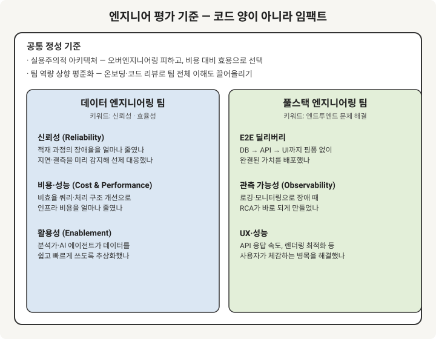

## 1. 1위를 공개할 수 있어야 할까?

나는 팀장이 평가에 확신이 있다면, "우리 팀 1위는 누구고 이유는 이거다"라고 팀원들 앞에서 말할 수 있어야 하지 않을까 생각한다.
다만 실제로 순위를 딱 선언하는 건 좋은 점과 걱정되는 점이 둘 다 있는 것 같다.

| | 내용 |
|---|---|
| 좋은 점 | 1위를 보면 이 조직이 어떤 성과와 태도를 소중하게 여기는지 한눈에 보인다. 팀장도 평가 기준을 더 또렷하게 다듬게 되고, 편향도 조심하게 된다. |
| 걱정되는 점 | 근소한 차이로 2~3위가 된 사람들이 박탈감을 느낄 수 있다. 성과가 제로섬처럼 느껴지면 코드 리뷰나 지식 공유도 줄어들 수 있다. |

> "내가 저 사람 코드를 리뷰해주면 내 순위가 밀리는 건 아닐까?" 이런 생각이 한 번이라도 들기 시작하면 팀 분위기가 많이 달라질 것 같다.
{: .prompt-warning }

그래서 순위 자체보다는 **어떤 기여가 좋았는지를 공개하는 쪽**이 더 낫지 않을까 싶다.
"이번 분기에 OOO 님이 주도한 프로젝트 덕분에 시스템 병목이 풀리고 리소스도 많이 줄었다. 이런 기여가 우리 팀이 지향하는 모습이다" 정도로 이야기하면, 1위인 사람의 노력도 인정받고 다른 팀원들도 위축되지 않을 것 같다.

## 2. 데이터 엔지니어·풀스택은 뭘로 평가할까

커밋 수나 코드 라인 수로 개발자를 평가하는 건 이제 조금 맞지 않는 방식 같다.
코드를 얼마나 썼는지보다는 **비즈니스와 시스템에 어떤 영향을 줬는지**를 보는 쪽이 자연스러운데, 직군마다 영향의 모양이 달라서 기준도 나눠서 생각해 봤다.

{: width="720" height="560"}

- **데이터 엔지니어링**은 시스템의 신뢰성과 효율성이 눈에 잘 띄는 지표다. 장애율을 얼마나 줄였는지, 비용을 얼마나 아꼈는지, 다른 사람이 데이터를 쓰기 편하게 만들었는지를 볼 수 있을 것 같다.
- **풀스택**은 사용자와 가까이 있어서 처음부터 끝까지 책임지고 해결하는 힘이 중요해 보인다. DB부터 UI까지 하나의 기능을 완결했는지, 장애가 났을 때 원인을 바로 찾을 수 있게 해뒀는지, 사용자가 체감하는 성능을 챙겼는지를 볼 수 있다.
- **공통 기준**은 숫자로 잡기는 어렵지만 사람들이 대체로 공감하는 요소들이다. 오버엔지니어링 없이 팀 상황에 맞게 선택하는 판단력, 그리고 팀 전체의 이해도를 높여주는 기여 정도가 있을 것 같다.

기준을 어떻게 전달하느냐도 중요한 것 같다. 평가 시트에 "파이프라인 안정성: 5점"이라고만 적으면 너무 추상적이라서, 분기 초에 **문제 형태로** 먼저 공유해 두면 더 이해하기 쉬울 것 같다.
예를 들면 "이번 분기 목표는 S3 적재 지연율을 줄이는 것과 장애 RCA 시간을 단축하는 것이다. 이 문제를 주도적으로 풀어주는 분이 가장 큰 기여를 하는 거라고 본다" 같은 식이다.

## 3. 그래도 결국 주관이 들어가지 않을까

기준을 아무리 잘 잡아도, 결국 사람을 비교하는 순간에는 주관이 들어갈 수밖에 없는 것 같다.
그런데 이건 꼭 나쁜 일만은 아니라고 생각한다. 100% 객관적인 평가가 가능하다면 팀장이 아니라 스크립트가 로그를 긁어서 점수를 매겨도 될 텐데, 그렇지는 않으니까 말이다.

주관이 필요한 순간은 이런 경우인 것 같다.

- **트레이드오프 판단**: 화려한 구조 대신 우리 팀 상황에 맞는 적정 기술을 고른 판단력은 숫자로 잘 드러나지 않는다.
- **예방된 장애**: 병목을 미리 찾아서 조용히 리팩토링한 사람과, 터진 장애를 멋지게 수습한 사람 중 누가 더 기여했을까? 지표로는 후자가 눈에 띄지만, 전자의 가치도 놓치지 않으면 좋겠다.
- **멘토링**: 주니어를 온보딩해 주는 건 조직 역량에 큰 도움이 되는데 정량화하기가 어렵다.

그래서 주관을 없애려고 하기보다는 **납득할 수 있는 주관**을 만드는 쪽이 현실적인 것 같다. 몇 가지 방법을 생각해 봤다.

1. **팩트를 근거로 설명한다.** "A가 일을 잘한다"보다는 "A가 파고든 RCA 덕분에 같은 이슈가 반복되지 않았다"처럼 구체적인 근거를 같이 이야기한다.
2. **동료의 시선도 참고한다.** 내가 좋게 본 사람을 동료들도 비슷하게 느끼고 있다면 판단에 좀 더 확신이 생긴다.
3. **우선순위를 미리 공유한다.** "이번 분기는 신규 개발보다 안정화와 데이터 정합성을 더 중요하게 보겠다"고 먼저 이야기해 두면, 결과가 주관적이더라도 받아들이기 수월할 것 같다.

## 4. 이런 걸 알면 동료 평가가 소극적이 되지 않을까

이건 내가 특히 걱정되는 부분이다. 내가 쓴 한 줄이 동료의 순위에 영향을 준다는 걸 알면, 조심스러워지거나 다들 좋은 말만 쓰게 될 수 있을 것 같다.
그러다 보면 평소의 날카로운 코드 리뷰나 아키텍처 토론까지 조금씩 위축될 수도 있다.

그래서 동료 평가는 **점수를 매기는 것(채점)보다 겪은 일을 이야기하는 것(증언)** 에 가깝게 설계하면 어떨까 싶다.

- 부담스러운 질문: "이 동료의 역량은 탁월한가요?" → 판단의 무게를 질문받은 사람이 다 짊어져야 한다.
- 편한 질문: "이번 분기에 이 동료와 협업하면서 가장 도움받았던 순간은 언제였나요?", "이 동료의 리뷰나 조언 중 내 문제를 푸는 데 도움이 된 건 뭐가 있나요?"

'나에게 어떤 도움이 됐는지'를 사실 위주로 적게 하면 훨씬 부담이 덜할 것 같다. 팀장은 그렇게 모인 이야기들을 보면서 평가의 근거로 삼으면 된다.
동료 평가는 순위를 정하는 투표용지라기보다는, 팀장이 직접 보지 못한 협업 모습을 비춰주는 조명 같은 역할이면 좋겠다.

## 5. 좋은 리더란

좋은 리더가 뭘까 생각해 보면, 팀원이 문제 해결에 집중할 수 있도록 **외부의 복잡한 일들을 대신 걸러주고, 성장할 수 있는 길을 만들어주는 사람**이 아닐까 싶다.

- **방향을 잡아주는 사람**: 모호한 요구사항을 팀이 따를 수 있는 기준으로 바꿔준다. "알아서 잘 해보자"보다는 비용 대비 효용 같은 기준을 먼저 잡아준다.
- **기초를 함께 다져주는 사람**: 답을 바로 알려주기보다 스스로 파고들 수 있게 돕는다. 에러만 고치는 게 아니라 진짜 원인(RCA)까지 보게 하고, 코드가 겉으로 어떻게 도는지보다 실제 실행 흐름을 이해하도록 도와준다.
- **외풍을 막아주는 사람**: 정답이 없는 상황에서 결정하고 그 책임을 진다. 타 부서의 무리한 요구로부터 팀을 지켜주고, 자기가 내린 평가나 방향에 대해서도 책임지는 모습이다.

## 6. 마이크로매니징 vs 완전한 위임

리더 스타일은 크게 두 방향으로 나뉘는 것 같다. 세세하게 챙기는 리더와, 권한을 거의 다 맡기고 믿어주는 리더다. 둘 다 장점이 있지만 조심할 점도 있다.

- **마이크로매니징**: 단기적으로는 품질이 안정되지만, 팀원이 승인받기 위한 코딩에 익숙해질 수 있다. 장애가 나도 스스로 원인을 파고들기보다 리더의 답을 기다리게 될 수도 있다.
- **완전한 위임**: 시니어끼리 모인 팀에서는 아주 잘 맞겠지만, 맥락이나 온보딩 없이 주니어에게 권한만 넘기면 신뢰라기보다 방임에 가까워질 수 있다. 오버엔지니어링이나 기술 부채로 이어질 수도 있다.

그래서 둘 중 하나를 고르기보다는 **상황에 맞게 섞는 것**이 좋겠다는 생각이 든다.

- **What / Why는 꼼꼼하게**: 왜 이 아키텍처를 쓰는지, 비용 대비 괜찮은 선택인지, 장애의 진짜 원인이 뭔지는 같이 깊게 들여다본다.
- **How는 맡기기**: 기준이 정해지고 팀의 기초 체력이 어느 정도 공유됐다면, 구현 방식은 팀원에게 맡겨본다.

"믿는다"는 말도 명확한 기준과 멘토링이 먼저 있을 때 더 힘을 갖는 것 같다.

## 7. 정무적이고 회의가 많은 리더와 일할 때

현실에서는 기술 이야기보다 정무와 회의가 중심인 리더를 만나는 경우도 많은 것 같다.
이럴 때 리더를 답답해하기만 하기보다는, 그 리더의 강점을 팀에 도움이 되는 쪽으로 활용해 보면 어떨까 하는 생각을 했다.

1. **기술 이야기를 리더가 쓰는 언어로 바꿔서 전달해 본다.** "레거시를 리팩토링해야 합니다"보다는 "이 병목을 두면 다음 달 프로모션 때 장애 위험이 있어서 미리 정리해 두려고 합니다"처럼 말하면 훨씬 잘 전달될 것 같다.
2. **기술적인 부분은 실무진이 먼저 챙겨본다.** 리더가 회의로 바쁜 동안 기술 표준이나 코드 리뷰 문화를 우리가 조금씩 만들어 가고, "실무는 저희가 안정적으로 맞춰둘게요"라고 공유하면 서로 편해질 수 있다.
3. **리더가 협상할 때 쓸 근거를 챙겨드린다.** 타 부서가 무리한 일정을 요청할 때 리더가 설득할 수 있도록 정확한 숫자와 사실을 정리해 드리면, 팀의 개발 시간을 지켜주는 데 큰 도움이 될 것 같다.

기술적인 이야기를 나눌 상대가 리더가 아니더라도, 동료들과 함께 배우고 성장할 방법은 얼마든지 있을 것 같다.

## 정리

| 주제 | 한 줄 |
|---|---|
| 1위 공개 | 순위보다 구체적인 기여와 임팩트를 공유하면 좋겠다 |
| 평가 기준 | 코드 양보다 신뢰성·비용·E2E 딜리버리·팀 역량 기여 |
| 주관 | 없애기보다 팩트·동료의 시선·사전 우선순위로 납득시키기 |
| 동료 평가 | 채점보다 협업 경험을 이야기하게 하기 |
| 좋은 리더 | 방향을 잡아주고, 기초를 다져주고, 외풍을 막아주는 사람 |
| 위임 | What/Why는 꼼꼼하게, How는 맡기기 |
| 정무형 리더 | 기술 이야기를 리더의 언어로 전하고, 실무는 우리가 챙기기 |
